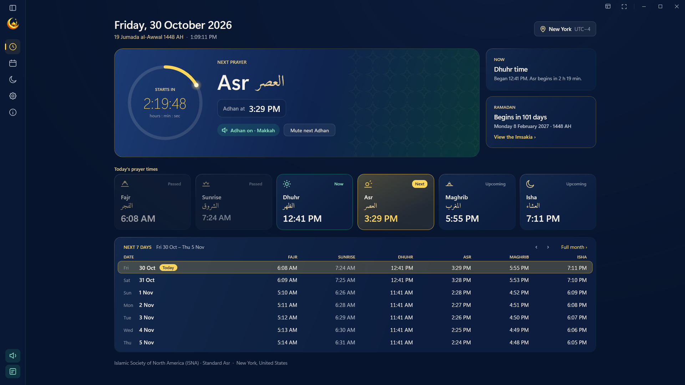
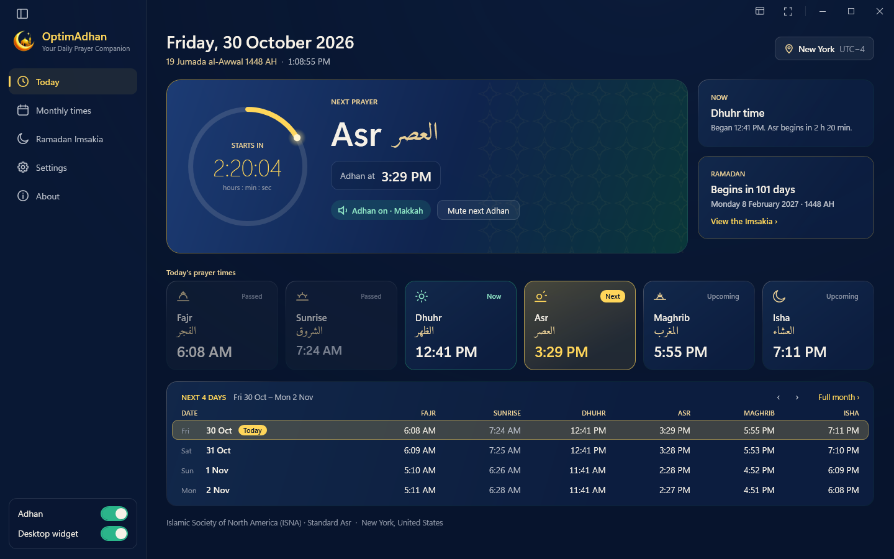
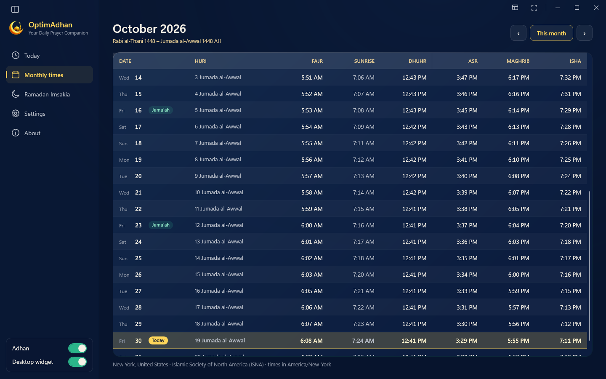
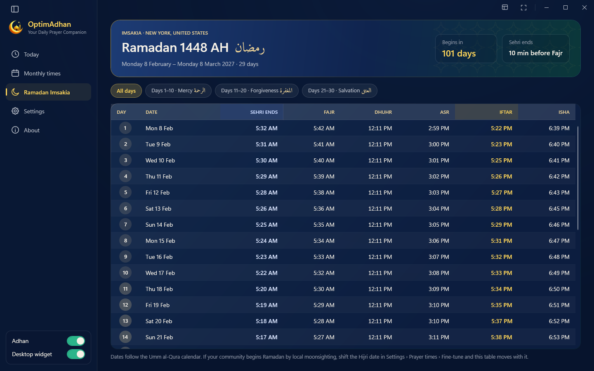
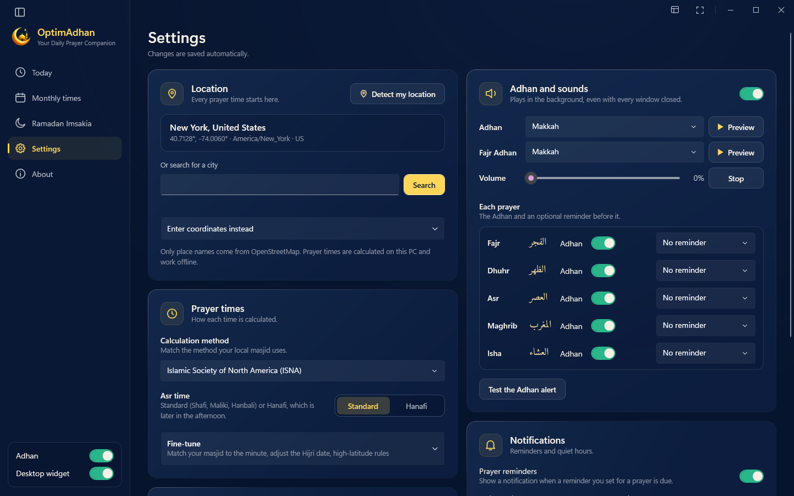
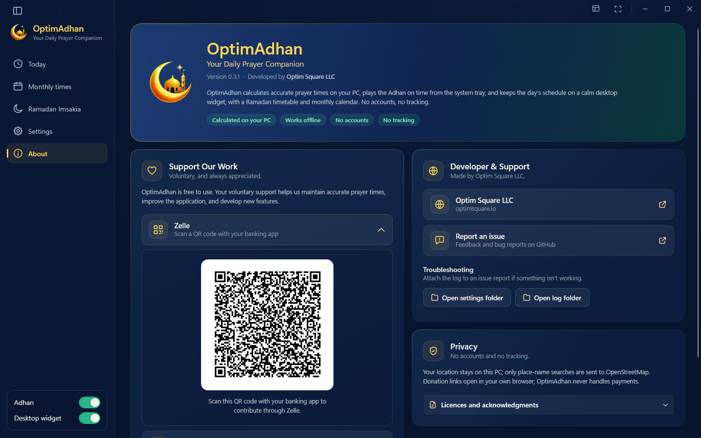
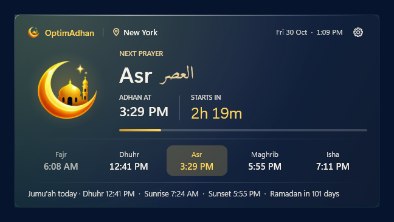

<p align="center">
  <picture>
    <source media="(prefers-color-scheme: dark)" srcset="assets/logos/optimadhan-horizontal-ivory.png">
    
  </picture>
</p>

<h3 align="center">Your Daily Prayer Companion for Windows</h3>

<p align="center">
  Accurate prayer times, the Adhan on time from the system tray, a calm desktop widget<br>
  and a complete Ramadan Imsakia. Calculated on your PC, with no accounts and no tracking.
</p>

<p align="center">
  <a href="https://github.com/optimsquare/OptimAdhan/releases/latest"></a>
</p>

<p align="center">
  <a href="https://github.com/optimsquare/OptimAdhan/releases/latest"></a>
  
  
  
</p>

<p align="center">
  
</p>

## Why OptimAdhan?

Most prayer-time tools live in a browser tab or on a phone. OptimAdhan lives on your Windows PC, where
many of us spend the working day. It starts quietly with Windows, keeps today's times on your desktop
and plays the Adhan at each prayer, even with every window closed.

- **Accurate.** Times are calculated on your PC with the proven [adhan](https://github.com/batoulapps/adhan-js)
  astronomical algorithms. They are checked against the reference implementation in 51,880 test cases and
  cross-checked with the AlAdhan service ([how we verify accuracy](docs/ACCURACY.md)).
- **Reliable.** No internet is needed once your location is set. The Adhan plays from the system tray,
  and if the PC was asleep at prayer time, OptimAdhan tells you what you missed.
- **Respectful of your privacy.** No accounts, no ads, no telemetry. Your location never leaves the PC.
- **Calm by design.** A midnight-navy and gold interface that sits quietly beside your work.

## Features

**Prayer times**
- 12 calculation methods (Muslim World League, ISNA, Umm al-Qura, Egyptian, Karachi, Dubai, Moonsighting
  Committee, Kuwait, Qatar, Singapore, Tehran, Turkey) plus custom Fajr and Isha angles
- Standard or Hanafi Asr, per-prayer minute adjustments, and high-latitude and polar-region rules
- Location by Windows location services, city search or coordinates, each with its own time zone and
  daylight saving time
- Hijri date (Umm al-Qura), adjustable by up to two days for local moonsighting

**Adhan and reminders**
- The Adhan from Makkah or Madinah, with a separate Fajr Adhan and a volume control
- Per-prayer Adhan switches and optional reminders 5 to 30 minutes before
- Mute the next Adhan, or everything for an hour, from the tray, and optionally stay quiet during
  full-screen presentations and games
- A compact "Now playing" card with Stop and Mute

**Today, Monthly and Ramadan**
- A Today dashboard with a live countdown, today's five prayers and the coming days; press F11 for a
  full-screen view
- A monthly timetable with Hijri dates and Jumu'ah marked
- A Ramadan Imsakia with Sehri and Iftar for every day of Ramadan, an adjustable Imsak and spoken countdowns
  before Sehri ends and Iftar

**Desktop widget**
- A frosted-glass widget in standard or compact size, showing the next prayer and a countdown
- Drag to place, lock, keep on top and adjust the glass tint

## Screenshots

<table>
  <tr>
    <td width="50%"><br><sub><b>Today:</b> the next prayer, today's times and the coming days</sub></td>
    <td width="50%"><br><sub><b>Monthly times:</b> the whole month with Hijri dates</sub></td>
  </tr>
  <tr>
    <td width="50%"><br><sub><b>Ramadan Imsakia:</b> Sehri and Iftar for every day of Ramadan</sub></td>
    <td width="50%"><br><sub><b>Settings:</b> location, calculation, Adhan, Ramadan and widget</sub></td>
  </tr>
  <tr>
    <td width="50%"><br><sub><b>About:</b> version, support and privacy</sub></td>
    <td width="50%" align="center">
      <br>
      <br>
      <sub><b>Desktop widget:</b> standard and compact</sub>
    </td>
  </tr>
</table>

## Download and install

1. Download **`OptimAdhan-<version>-x64.msi`** from the [latest release](https://github.com/optimsquare/OptimAdhan/releases/latest).
2. Open the file. OptimAdhan installs for your Windows account, with no administrator rights and
   nothing else to install. The .NET runtime is included.
3. OptimAdhan starts when installation finishes. Choose your location, and you're done.

> [!NOTE]
> The installer is not code-signed yet, so Windows SmartScreen may say it "protected your PC". Select
> **More info › Run anyway** to continue. Each release lists the installer's SHA-256 checksum so you can
> confirm your download is genuine.

To update, install the newer MSI over the old one; your settings are kept. To uninstall, go to
**Settings › Apps › Installed apps › OptimAdhan › Uninstall**.

### System requirements

| | |
|---|---|
| Operating system | Windows 10 version 1809 or later, or Windows 11 (64-bit, x64) |
| Disk space | About 190 MB |
| Internet | Only to search for a city by name. Prayer times work offline. |
| Permissions | None. Installs per user, without administrator rights. |

## Privacy

OptimAdhan has no accounts, no ads and no telemetry. Prayer times are calculated on your PC, and your
location is stored only in your own settings file. The only network request the app makes is a place-name
search to OpenStreetMap, when you search for a city. The diagnostic log stays on your PC. See
[docs/SECURITY.md](docs/SECURITY.md) for details and for reporting a vulnerability.

## Support and feedback

- **Found a bug or have an idea?** [Open an issue](https://github.com/optimsquare/OptimAdhan/issues/new).
  Attaching the log (About › Open log folder) helps.
- **Support our work.** OptimAdhan is free. If it helps you, you can contribute through Zelle or PayPal
  from the About page. Contributions are always voluntary.

## For developers

Requires the **.NET 10 SDK** on Windows. Building the installer also needs WiX v5
(`dotnet tool install -g wix --version 5.0.2` and `wix extension add -g WixToolset.Util.wixext/5.0.2`).

```powershell
dotnet test                                    # 56 offline tests, including 51,880 adhan-js parity cases
$env:OPTIMADHAN_NETWORK_TESTS = "1"; dotnet test   # + cross-checks against the AlAdhan API (needs internet)

$env:OPTIMADHAN_DEV = "1"                      # developer mode: separate settings, never touches the Run key
dotnet run --project src/OptimAdhan.App

powershell -ExecutionPolicy Bypass -File tools\build-installer.ps1
# -> artifacts\installer\OptimAdhan-<version>-x64.msi (self-contained, per-user)
```

| Where things live on a user's PC | |
|---|---|
| Application | `%LocalAppData%\Programs\OptimAdhan` |
| Settings | `%AppData%\Optim Square\OptimAdhan\settings.json` |
| Diagnostic log (local only) | `%LocalAppData%\Optim Square\OptimAdhan\logs` |
| Start at sign-in | `HKCU\Software\Microsoft\Windows\CurrentVersion\Run\OptimAdhan` |
| Sounds (replaceable) | `<install folder>\Assets\Audio\sounds.json` and audio files |

**Replacing the Adhan recordings:** put the new files in `src/OptimAdhan.App/Assets/Audio/Adhan/` and list
them in `Assets/Audio/sounds.json` (id, name, file). No code changes are needed. Settings refer to sounds by
`id`, so keep `makkah` and `madina`, or users fall back to the first sound listed.

**Brand assets:** the app uses the official artwork from `assets/`, copied into
`src/OptimAdhan.App/Assets/Brand/`. To update the branding, replace those files and rebuild.

More documentation: [Architecture](docs/ARCHITECTURE.md) · [Accuracy](docs/ACCURACY.md) ·
[Security](docs/SECURITY.md) · [Changelog](CHANGELOG.md)

## Licence

© Optim Square LLC. All rights reserved. The source is public for transparency and review. No licence to
reuse or redistribute it is granted unless stated otherwise.

Third-party components keep their own licences: the prayer-time algorithms are ported from
[adhan-js](https://github.com/batoulapps/adhan-js) (MIT, Batoul Apps);
[GeoTimeZone](https://github.com/mattjohnsonpint/GeoTimeZone) (MIT); the
[Amiri](https://github.com/aliftype/amiri) font (SIL OFL 1.1); place names © OpenStreetMap contributors
via Nominatim.

---

<p align="center">
  Made with care by <a href="https://optimsquare.io"><b>Optim Square LLC</b></a>
</p>
